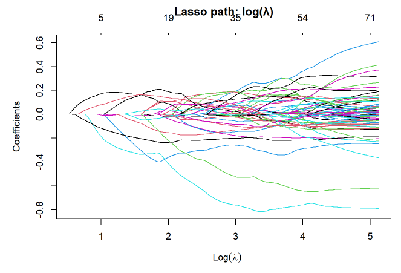

# Bayes Lasso Regression

## Coefficient Path of lasso Regression:



## Laplace (double-exponential) Prior:

Tibshirani, who invented the lasso, noticed that the lasso answer is exactly the peak of the posterior if you use a particular prior: a **Laplace (double-exponential) prior** on each coefficient.

This prior is shaped like a tent, with a sharp spike at zero and tails that go out gently. It says “I believe most coefficients are probably near zero, but a few could be large.” That is the same idea as the lasso penalty, and the absolute-value penalty $|\beta|$ is just the shape of that prior.

The Bayesian lasso of @park2008 places the following prior on the regression coefficients:

$$
\pi(\boldsymbol{\beta} \mid \sigma^2)=\prod_{j=1}^{p}\frac{\lambda}{2\sqrt{\sigma^2}}\;e^{-\lambda|\beta_j|/\sqrt{\sigma^2}}
$$ {#eq-laplace-prior}

### Reading the equation

**Left side, $\pi(\boldsymbol{\beta} \mid \sigma^2)$.** This is the *prior*. It says how plausible each possible value of $\boldsymbol{\beta}$ is *before* looking at any data, given the noise level $\sigma^2$. Taller means more plausible.

**The product $\prod$.** The coefficients for $p$ predictors are treated as independent, so the prior for the whole vector is each coefficient's prior multiplied together. That means we only need to understand one factor.

**One factor.** Writing $\sigma = \sqrt{\sigma^2}$, a single coefficient has prior

$$
\frac{\lambda}{2\sigma}\;e^{-\lambda|\beta_j|/\sigma}.
$$

- $e^{-\lambda|\beta_j|/\sigma}$ is the **tent shape**.
    - At $\beta_j = 0$ the exponent is 0, so $e^0 = 1$ and the curve is at its highest.
    - As $|\beta_j|$ grows, the exponent becomes more negative and the curve drops.
    - The absolute value makes the curve symmetric and gives it a **sharp point at 0**.
- $\frac{\lambda}{2\sigma}$ is a **scaling constant**. It makes the total area under the curve equal 1, which any probability density requires. It is also the height of the peak.
- $\lambda$ controls the **sharpness**. A bigger $\lambda$ gives a taller, narrower tent, meaning you are more confident the coefficient is near 0.
- $\sigma$ controls the **spread**. Bigger noise $\sigma$ widens the tent. Conditioning the prior on $\sigma^2$ is the paper's key design choice, and it guarantees that the posterior has a single peak.

@fig-laplace-prior shows this tent for three values of $\lambda$, alongside the bell-curve prior that corresponds to ridge regression.

### How the prior becomes the lasso penalty

By Bayes' rule, the posterior is proportional to the likelihood times the prior:

$$
\pi(\boldsymbol{\beta} \mid \tilde{\mathbf{y}}, \sigma^2) \;\propto\;
\underbrace{\exp\!\left\{-\frac{\|\tilde{\mathbf{y}} - \mathbf{X}\boldsymbol{\beta}\|_2^2}{2\sigma^2}\right\}}_{\text{likelihood}}
\;\times\;
\underbrace{\exp\!\left\{-\frac{\lambda}{\sigma}\sum_{j=1}^p |\beta_j|\right\}}_{\text{prior}}.
$$

Taking the negative log and multiplying by $2\sigma^2$ gives

$$
\|\tilde{\mathbf{y}} - \mathbf{X}\boldsymbol{\beta}\|_2^2 \;+\; 2\sigma\lambda \sum_{j=1}^p |\beta_j|.
$$

- The likelihood contributes the **sum of squared residuals**.
- The prior contributes a **sum of absolute values**, which is the $L_1$ penalty.

The posterior peak (the mode) is the $\boldsymbol{\beta}$ that minimizes this expression, which is exactly the lasso problem with penalty parameter $2\sigma\lambda$. So the lasso estimate is the posterior mode under the Laplace prior. The Bayesian lasso goes further by using the *entire* posterior distribution, which provides credible intervals for each coefficient.

```{python}

#| label: fig-laplace-prior
#| fig-cap: "The Laplace (double-exponential) prior behind the lasso, compared with the normal prior behind ridge regression, for three values of λ. The Laplace density has a sharp peak at 0 and gentle tails."
#| code-fold: true
#| code-summary: "Show code"

import numpy as np
import matplotlib.pyplot as plt
from math import erf, sqrt

sigma = 1.0                      # noise standard deviation (set to 1 for the picture)
lams = [0.5, 1.5, 3.0]           # small, medium, large lambda
beta = np.linspace(-4, 4, 1000)  # possible coefficient values

blue, orange = "#2a78d6", "#eb6834"

fig, axes = plt.subplots(1, 3, figsize=(12, 3.8), sharey=True)

for ax, lam in zip(axes, lams):
    # Laplace prior, equation (3) for a single coefficient
    laplace = lam / (2 * sigma) * np.exp(-lam * np.abs(beta) / sigma)

    # Normal prior with the same variance as the Laplace (variance = 2*sigma^2/lam^2)
    sd = np.sqrt(2) * sigma / lam
    normal = np.exp(-beta**2 / (2 * sd**2)) / (sd * np.sqrt(2 * np.pi))

    # Shade the region |beta| < 0.5
    near0 = np.abs(beta) < 0.5
    ax.fill_between(beta[near0], laplace[near0], color=blue, alpha=0.18)

    ax.plot(beta, laplace, color=blue, lw=2.5, label="Laplace prior (lasso)")
    ax.plot(beta, normal, color=orange, lw=2, ls="--", label="Normal prior (ridge)")

    # Peak marker and label
    peak = lam / (2 * sigma)
    ax.plot(0, peak, "o", color=blue, ms=7, mec="white", mew=1.5)
    ax.annotate(f"sharp peak\nheight = λ/(2σ) = {peak:.2f}",
                xy=(0, peak), xytext=(25, 0), textcoords="offset points",
                fontsize=9, va="center", arrowprops=dict(arrowstyle="-", color="gray"))

    # Tail label
    ax.annotate("gentle tails", xy=(2.5, lam / (2 * sigma) * np.exp(-lam * 2.5 / sigma)),
                xytext=(0, 40), textcoords="offset points", ha="center", fontsize=9,
                arrowprops=dict(arrowstyle="-", color="gray"))

    # Probability that |beta| < 0.5 under each prior
    p_lap = 1 - np.exp(-lam * 0.5 / sigma)
    p_norm = erf(0.5 / (sd * sqrt(2)))
    ax.set_title(f"λ = {lam}\nP(|β| < 0.5): Laplace {p_lap:.0%}, Normal {p_norm:.0%}",
                 fontsize=10)
    ax.set_xlabel("Coefficient value (β)")
    ax.axvline(0, color="gray", lw=0.8, ls=":")
    ax.spines[["top", "right"]].set_visible(False)

axes[0].set_ylabel("Prior plausibility (density)")
axes[0].legend(loc="upper left", fontsize=8, frameon=False)
axes[0].set_ylim(0, 1.9)

plt.tight_layout()
plt.show()
```

### How to read the picture

* **The x-axis** is a possible value for one coefficient β. 
* **The y-axis** is how plausible the prior says that value is, so higher means more believable before seeing data.
* **The blue tent** is the Laplace prior from equation (9.1). It peaks at β = 0 and falls off symmetrically on both sides.
* **The sharp point** at 0 is the |β| in the exponent. This corner is what lets the posterior peak land exactly on zero, which gives the lasso its exact zeros.
* **The gentle tails** mean a coefficient can still be large if the data push hard enough. The tent doesn’t forbid big values, it just considers them less likely.
* **The orange dashed** curve is the normal (bell curve) prior that corresponds to ridge regression, drawn with the same overall spread. It is smooth and rounded at 0, so it has no corner to produce exact zeros. It also puts less weight on the far tails.
* **The shaded region** and the two boxes show the “most coefficients are near zero” idea in numbers. The tent puts more of its probability within ±0.5 of zero than the bell curve does.

### The Big Picture
Increasing $\lambda$ makes the tent taller and narrower, so you’re more strongly betting that coefficients are near zero. In lasso terms, that is a bigger penalty and more coefficients dropped. Decreasing $\lambda$ flattens the tent, which is a weaker penalty, and the lasso moves toward ordinary regression.

## Choosing λ:

The lasso usually picks $\lambda$ by cross-validation. The Bayesian version offers two alternatives:

* Empirical Bayes (marginal maximum likelihood): choose the $\lambda$ that makes the observed data most probable. It’s computed by repeatedly running the sampler and updating $\lambda$.
* Hyperprior: treat $\lambda$ as another unknown, give it its own prior, and let the sampler estimate it along with everything else.

## Comparing Lasso vs. Bayesian Lasso:

| | Lasso | Bayesian lasso |
|:--|:--|:--|
| Output | One set of coefficients | A distribution for each coefficient |
| Uncertainty | Hard to get reliably | Credible intervals built in |
| Exact zeros | Yes | No (use intervals instead) |
| Computation | Fast | Slower (simulation) |
| Choosing $\lambda$ | Cross-validation | Empirical Bayes or a hyperprior |

: Comparison of the lasso and the Bayesian lasso. {#tbl-lasso-comparison}