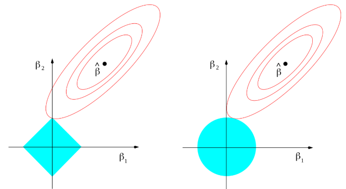
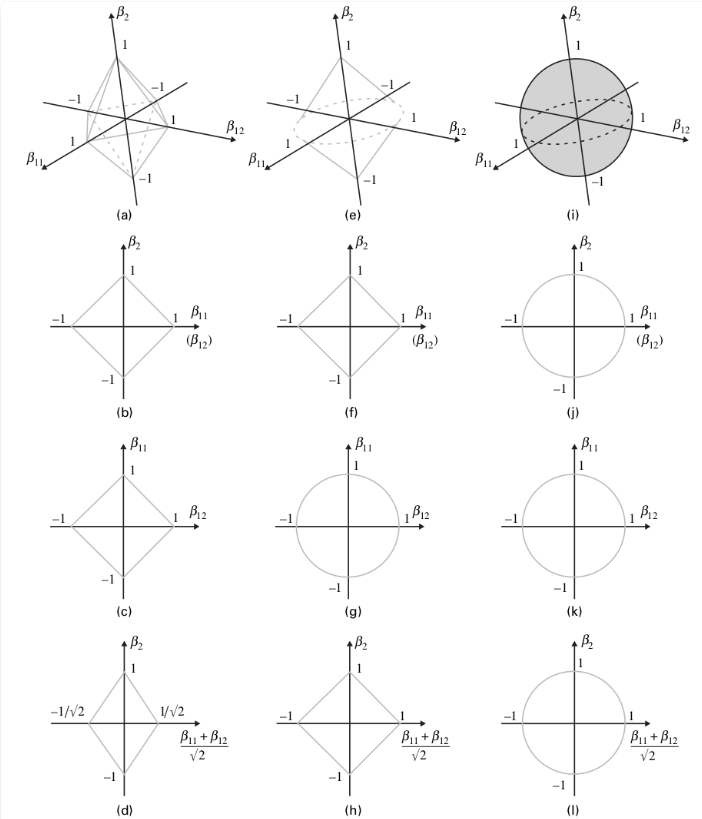

# Group Lasso

**Paper Title:** A fast unified algorithm for solving group-lasso penalize learning problems

## Motivation

Many models contain a **categorical variable** that is allowed to *interact* with a continuous predictor. Coding the categorical variable takes several columns; coding its interactions with a flexible (spline) effect takes even more. Those columns belong together: they are all different ways of asking one question, "does this group behave differently from the others?"

This chapter motivates the **group lasso** in four steps:

1. Introduce a categorical variable, and its interactions, into a regression model.
2. Show why we need **group-specific regularization** when some groups are small.
3. Show what the **lasso** can and cannot do about it.
4. Show how the **group lasso** fixes the part the lasso gets wrong.

The structure and plots follow the Interactions chapter of the class notes ([tgstewart.cloud/ipm/interactions.html](https://tgstewart.cloud/ipm/interactions.html)), in particular its sections on group-specific non-linear relationships, group-specific regularization, and lasso regression. The notes use NHANES (`Age` predicting blood pressure, with `Race1` as the grouping variable). Here the same ideas are rebuilt in Python on an exoplanet catalog:

| Role | This chapter |
|---|---|
| Outcome |`P_ESI`, the Earth Similarity Index |
| Continuous predictor | $\log_{10}$ equilibrium temperature (`P_TEMP_EQUIL`) |
| Grouping variable | `P_TYPE`, planet type (6 levels) |

## Setup and and data

```{python}
#| label: setup
#| code-fold: True

# importing relavent libraries
import numpy as np
import pandas as pd
import matplotlib.pyplot as plt
import statsmodels.api as sm
from statsmodels.nonparametric.smoothers_lowess import lowess
from sklearn.linear_model import lasso_path
from sklearn.model_selection import KFold
from IPython.display import display
from sklearn.linear_model import Lasso

plt.rcParams.update({
    "figure.dpi": 110, "axes.spines.top": False, "axes.spines.right": False,
    "axes.grid": True, "grid.color": "#e6e6e3", "grid.linewidth": 0.6,
    "axes.edgecolor": "#8a8a85", "axes.labelcolor": "#2b2b2a",
    "xtick.color": "#52514e", "ytick.color": "#52514e", "font.size": 9,
})
INK, MUTED = "#2b2b2a", "#8a8a85"

# fixed categorical order (one colour per planet type, never reassigned)
PALETTE = ["#2a78d6", "#eb6834", "#1baf7a", "#eda100", "#e87ba4", "#6250d6"]
```

Each planet observation has a Earth-Like Similarity Index (ESI) score where if the ESI is closer to 1, more Earth-Like and if the ESI is closer ot 0, less Earth-Like. This is the target variable. The predictor variables include numerical feature equilibrium temperature in Kelvin and categorical feature planet type. The sample size of planets n = 5,358 after dropping rows with missing values.

Planet types are ordered by increasing mass, so the **last level, Jovian, is the largest group and serves as the reference level** throughout.

```{python}
#| label: load-data
#| code-fold: True

# loading the data and taking the log of the planet equilibrium temp
raw = pd.read_csv("habitable_worlds_catalog_trimmed.csv")
planets = raw.dropna(subset=["P_ESI", "P_TEMP_EQUIL", "P_TYPE"]).copy()
planets["logT"] = np.log10(planets["P_TEMP_EQUIL"])

# specify the level/categories of the categorical variable planet type
levels = ["Miniterran", "Subterran", "Terran", "Superterran", "Neptunian", "Jovian"]
K = len(levels)
planets["P_TYPE"] = pd.Categorical(planets["P_TYPE"], categories=levels)
planets = planets.reset_index(drop=True)

# specify outcome var, numerical predictor var, and categorical predictor var
x = planets["logT"].to_numpy()
y = planets["P_ESI"].to_numpy()
g = planets["P_TYPE"].cat.codes.to_numpy()  

n = len(y)
n_g = np.bincount(g, minlength=K)
w = n_g / n 

# preview the original data (all original columns)
display(raw.head())

# display the data
print(f"Complete cases: {n}  (of {len(raw)} rows)")
pd.DataFrame({"P_TYPE": levels, "n": n_g, "proportion": w.round(4),
              "mean ESI": [y[g == j].mean().round(3) for j in range(K)]})
```

The groups are badly unbalanced: one group has thousands of planets and another has fewer than ten.

```{python}
#| label: fig-raw-unlogged
#| fig-cap: "ESI against equilibrium temperature on the raw scale (no log), one panel per planet type. Compare with the log10 version below."
#| code-fold: True

x_raw = planets["P_TEMP_EQUIL"].to_numpy()

fig, axes = plt.subplots(2, 3, figsize=(10, 5.4), sharex=True, sharey=True)
for j, ax in enumerate(axes.flat):
    m = g == j
    ax.scatter(x_raw[m], y[m], s=7, alpha=0.5, color=PALETTE[j], linewidths=0)
    ax.set_title(f"{levels[j]} (n={n_g[j]})", fontsize=9.5, color=INK, loc="left")
for ax in axes[1]:
    ax.set_xlabel("equilibrium temp (K)")
for ax in axes[:, 0]:
    ax.set_ylabel("ESI")
fig.tight_layout()
plt.show()
```

Because the planet equilibrium temperature (K) contains a wide range of values from ~1 K to ~7,800 K, the x-axis is stretched and the graph clusters together due to a few outlier planets whose temperatures are near the ~7,800 K range. Therefore, we will take the log10 of the equilibrium temperature.

```{python}
#| label: fig-raw
#| fig-cap: "ESI against log10 equilibrium temperature, one panel per planet type. Group sizes range from 8 to over 1,500 planets."
#| code-fold: True

fig, axes = plt.subplots(2, 3, figsize=(10, 5.4), sharex=True, sharey=True)
for j, ax in enumerate(axes.flat):
    m = g == j
    ax.scatter(x[m], y[m], s=7, alpha=0.5, color=PALETTE[j], linewidths=0)
    ax.set_title(f"{levels[j]} (n={n_g[j]})", fontsize=9.5, color=INK, loc="left")
for ax in axes[1]:
    ax.set_xlabel(r"$\log_{10}$ equilibrium temp (K)")
for ax in axes[:, 0]:
    ax.set_ylabel("ESI")
fig.tight_layout()
plt.show()
```

## Categorical variables and interactions

### Implimenting a Restricted Cubic Spline

To let the effect of temperature be non-linear, we use a restricted cubic spline. With four knots the basis has three columns, $x$, $x'$, $x''$. The knots are fixed once and reused in every model, so the models differ only in **which coefficients are shared across groups**, not in the basis.

```{python}
#| label: rcs-basis
#| code-fold: True

def rcs(v, knots):
    # restricted cubic spline basis: returns len(knots)-1 columns (x, x', x'', ...)
    t = np.asarray(knots, float); k = len(t)
    pos = lambda u: np.maximum(u, 0.0) ** 3
    cols = [v]
    for j in range(k - 2):
        cols.append((pos(v - t[j])
                     - pos(v - t[k - 2]) * (t[k - 1] - t[j]) / (t[k - 1] - t[k - 2])
                     + pos(v - t[k - 1]) * (t[k - 2] - t[j]) / (t[k - 1] - t[k - 2]))
                    / (t[k - 1] - t[0]) ** 2)
    return np.column_stack(cols)

knots = np.quantile(x, [0.05, 0.35, 0.65, 0.95])
B = rcs(x, knots)
print("knots:", knots.round(3), "| basis columns:", B.shape[1])
```

Write $b(x) = (x, x', x'')$ for the spline basis and $I_j$ for the indicator of planet type $j$ (Jovian is the reference). The class notes walk up a ladder of models that share progressively less information between groups:

**Fully shared** (one curve for every planet type; 4 coefficients):
$$E[\text{ESI}\mid x] = \beta_0 + \beta_1 x + \beta_2 x' + \beta_3 x''$$
$$E[\text{ESI} \mid \text{temp}] = \beta_0 + \beta_1 \text{temp} + \beta_2 \text{temp}' + \beta_3 \text{temp}''$$

**Partial sharing** (same shape, a different level for each type; 4 + 5 = 9 coefficients):
$$E[\text{ESI}\mid x, \text{type}] = \beta_0 + \beta_1 x + \beta_2 x' + \beta_3 x'' + \sum_{j=1}^{5}\gamma_j I_j$$

$$
\begin{align*}
E[\text{ESI}\mid \text{temp}, \text{type}] &= \beta_0 + \beta_1\,\text{temp} + \beta_2\,\text{temp}^{\prime} + \beta_3\,\text{temp}^{\prime\prime} \\
&\quad + \beta_4\,I(\text{Miniterran}) + \beta_5\,I(\text{Subterran}) + \beta_6\,I(\text{Terran}) \\
&\quad + \beta_7\,I(\text{Superterran}) + \beta_8\,I(\text{Neptunian})
\end{align*}
$$

**Full interaction** (every type gets its own curve; $4 + 5 + 15 = 24$ coefficients):
$$E[\text{ESI}\mid x, \text{type}] = \beta_0 + \sum_{m=1}^3 \beta_m b_m(x) + \sum_{j=1}^{5}\left[\gamma_j I_j + \sum_{m=1}^3 \delta_{jm}\, I_j\, b_m(x)\right]$$

$$
\begin{align*}
E[\text{ESI}\mid \text{temp}, \text{type}] &= \beta_0 + \beta_1\,\text{temp} + \beta_2\,\text{temp}^{\prime} + \beta_3\,\text{temp}^{\prime\prime} \\
&\quad + \beta_4\,I(\text{Miniterran}) + \beta_5\,\text{temp}\cdot I(\text{Miniterran}) + \beta_6\,\text{temp}^{\prime}\cdot I(\text{Miniterran}) + \beta_7\,\text{temp}^{\prime\prime}\cdot I(\text{Miniterran}) \\
&\quad + \beta_8\,I(\text{Subterran}) + \beta_9\,\text{temp}\cdot I(\text{Subterran}) + \beta_{10}\,\text{temp}^{\prime}\cdot I(\text{Subterran}) + \beta_{11}\,\text{temp}^{\prime\prime}\cdot I(\text{Subterran}) \\
&\quad + \beta_{12}\,I(\text{Terran}) + \beta_{13}\,\text{temp}\cdot I(\text{Terran}) + \beta_{14}\,\text{temp}^{\prime}\cdot I(\text{Terran}) + \beta_{15}\,\text{temp}^{\prime\prime}\cdot I(\text{Terran}) \\
&\quad + \beta_{16}\,I(\text{Superterran}) + \beta_{17}\,\text{temp}\cdot I(\text{Superterran}) + \beta_{18}\,\text{temp}^{\prime}\cdot I(\text{Superterran}) + \beta_{19}\,\text{temp}^{\prime\prime}\cdot I(\text{Superterran}) \\
&\quad + \beta_{20}\,I(\text{Neptunian}) + \beta_{21}\,\text{temp}\cdot I(\text{Neptunian}) + \beta_{22}\,\text{temp}^{\prime}\cdot I(\text{Neptunian}) + \beta_{23}\,\text{temp}^{\prime\prime}\cdot I(\text{Neptunian})
\end{align*}
$$

**No sharing** (one separate model per planet type; 4 coefficients each, 6 × 4 = 24 in total):

$$
\begin{align*}
E[\text{ESI}\mid \text{temp}, \text{type}=\text{Miniterran}] &= \beta^{(\text{Mini})}_0 + \beta^{(\text{Mini})}_1\,\text{temp} + \beta^{(\text{Mini})}_2\,\text{temp}^{\prime} + \beta^{(\text{Mini})}_3\,\text{temp}^{\prime\prime} \\
E[\text{ESI}\mid \text{temp}, \text{type}=\text{Subterran}] &= \beta^{(\text{Sub})}_0 + \beta^{(\text{Sub})}_1\,\text{temp} + \beta^{(\text{Sub})}_2\,\text{temp}^{\prime} + \beta^{(\text{Sub})}_3\,\text{temp}^{\prime\prime} \\
E[\text{ESI}\mid \text{temp}, \text{type}=\text{Terran}] &= \beta^{(\text{Ter})}_0 + \beta^{(\text{Ter})}_1\,\text{temp} + \beta^{(\text{Ter})}_2\,\text{temp}^{\prime} + \beta^{(\text{Ter})}_3\,\text{temp}^{\prime\prime} \\
E[\text{ESI}\mid \text{temp}, \text{type}=\text{Superterran}] &= \beta^{(\text{Sup})}_0 + \beta^{(\text{Sup})}_1\,\text{temp} + \beta^{(\text{Sup})}_2\,\text{temp}^{\prime} + \beta^{(\text{Sup})}_3\,\text{temp}^{\prime\prime} \\
E[\text{ESI}\mid \text{temp}, \text{type}=\text{Neptunian}] &= \beta^{(\text{Nep})}_0 + \beta^{(\text{Nep})}_1\,\text{temp} + \beta^{(\text{Nep})}_2\,\text{temp}^{\prime} + \beta^{(\text{Nep})}_3\,\text{temp}^{\prime\prime} \\
E[\text{ESI}\mid \text{temp}, \text{type}=\text{Jovian}] &= \beta^{(\text{Jov})}_0 + \beta^{(\text{Jov})}_1\,\text{temp} + \beta^{(\text{Jov})}_2\,\text{temp}^{\prime} + \beta^{(\text{Jov})}_3\,\text{temp}^{\prime\prime}
\end{align*}
$$

The $\gamma_j$ and $\delta_{jm}$ are the *interaction* coefficients: they say how type $j$ departs from the reference. For $G$ groups and a spline with $p$ terms, the interaction model spends $(G-1)(p+1)$ extra coefficients, and each group's curve is estimated from **only that group's rows**.

The groups within the categorical variable can be converted into indicator/dummy/binary variables

```{python}
#| label: designs

# convert the groups within the categorical variable into indicator/dummy variables 
def treat_dummies(g):
    # g holds one integer per planet, 0 to 5, for the six types.
    # np.eye(K) is the 6×6 identity matrix. 
    # Indexing it with [g] picks row g[i] for each planet, so planet i gets a row with a 1 in its type’s position and 0s elsewhere. 
    # The result is an n×6 table of indicators.
    # [:, :-1] drops the last column (Jovian), leaving n×5. A planet that is Jovian is all zeros, which is what makes Jovian the reference level.
    return np.eye(K)[g][:, :-1] # reference group = last level (Jovian)

# builds the design matrix, the table of predictor columns, for one of the three models
# B is the spline basis (n×3: the columns temp, temp', temp'')
# kind picks the model.
def design(kind, B, g):
    # ones is a column of 1s that supplies the intercept (n×1)
    ones, T = np.ones((len(B), 1)), treat_dummies(g)
    # Fully sharing: hstack places arrays side by side: intercept + 3 spline columns = 4 columns
    if kind == "shared":
        return np.hstack([ones, B])
    # Partial sharing: the same plus the 5 indicators = 9 columns
    if kind == "offset":
        return np.hstack([ones, B, T])
    # Full interaction: the 9 columns above, plus the products of the spline columns and each indicator
    if kind == "interaction":
        return np.hstack([ones, B, T] + [B * T[:, [j]] for j in range(K - 1)])
    # If kind is any other string, stop with an error
    raise ValueError(kind)

# For each model name, build its design matrix, fit ordinary least squares to predict ESI (y), and store the fitted model in a dictionary under that name
fits = {k: sm.OLS(y, design(k, B, g)).fit() for k in ["shared", "offset", "interaction"]}

pd.DataFrame({"model": list(fits),
              "coefficients": [int(f.df_model + 1) for f in fits.values()],
              "in-sample R2": [round(f.rsquared, 3) for f in fits.values()],
              "sigma": [round(np.sqrt(f.scale), 4) for f in fits.values()]})
```

- $y$ is the $n \times 1$ vector of ESI values.
- $\mathbf 1$ is the $n\times 1$ column of ones (ones).
- $B = [\,b_1\; b_2\; b_3\,]$ is the $n \times 3$ spline basis, with columns $\text{temp}$, $\text{temp}'$, $\text{temp}''$.
- $T = [\,t_1\; t_2\; t_3\; t_4\; t_5\,]$ is the $n \times 5$ indicator table (treat_dummies). Column $t_j$ is 1 for planets of type $j$ and 0 otherwise. Jovian is the all-zero reference.

To plot each fitted curve we evaluate it over the observed temperature range of each group.

```{python}
#| label: curve-helpers
#| code-fold: True

# preparing the curves for plotting 

grid = {j: np.linspace(x[g == j].min(), x[g == j].max(), 120) for j in range(K)}

def ols_curves(kind, fit):
    out = {}
    for j in range(K):
        xs = grid[j]; Bg = rcs(xs, knots); gg = np.full(len(xs), j)
        sf = fit.get_prediction(design(kind, Bg, gg)).summary_frame(alpha=0.05)
        out[j] = (xs, sf["mean"].to_numpy(), sf["mean_ci_lower"].to_numpy(), sf["mean_ci_upper"].to_numpy())
    return out
```

### Fully shared: one curve for everyone

```{python}
#| label: fig-shared
#| fig-cap: "Fully shared model: one temperature-ESI curve (with 95% confidence band) for all planet types."
#| code-fold: True

xs = np.linspace(x.min(), x.max(), 200)
sf = fits["shared"].get_prediction(design("shared", rcs(xs, knots), np.zeros(len(xs), int))).summary_frame()
fig, ax = plt.subplots(figsize=(6.2, 3.8))
ax.scatter(x, y, s=5, alpha=0.25, color=MUTED, linewidths=0)
ax.fill_between(xs, sf["mean_ci_lower"], sf["mean_ci_upper"], color=PALETTE[0], alpha=0.2, lw=0)
ax.plot(xs, sf["mean"], color=PALETTE[0], lw=2)
ax.set_xlabel(r"$\log_{10}$ equilibrium temp (K)"); ax.set_ylabel("ESI")
plt.show()
```

### Partial sharing: same shape, shifted

Adding the type main effect, without interactions, gives parallel curves: same shape, different level.

```{python}
#| label: fig-offset
#| fig-cap: "Partial sharing: the planet-type main effect shifts a common curve up or down. The curves are parallel by construction."
#| code-fold: True

cur = ols_curves("offset", fits["offset"])
fig, ax = plt.subplots(figsize=(6.6, 4))
for j in range(K):
    xs, yh, lo, hi = cur[j]
    ax.plot(xs, yh, color=PALETTE[j], lw=2, label=levels[j])
ax.set_xlabel(r"$\log_{10}$ equilibrium temp (K)"); ax.set_ylabel("fitted ESI")
ax.legend(frameon=False, ncol=2, fontsize=8)
plt.show()
```

### Full interaction: the shape differs by type

Replacing `+` with `*` in the formula (here: multiplying every spline column by every type indicator) lets each type have its own curve. The figures shows one panel per group, fitted curve and 95% confidence band.

```{python}
#| label: fig-interaction
#| fig-cap: "Full-interaction model: each planet type gets its own curve (95% confidence band, shaded). Compare the width of the bands for the large groups (bottom row) with the two smallest groups (top left)."
#| code-fold: True

def facet_curves(curve_sets, ylim=(0, 1), show_points=True, figsize=(10.5, 5.8)):
    """curve_sets: list of dicts {label, curves{j:(xs,yh,lo,hi)}, color, ls, lw, band}."""
    fig, axes = plt.subplots(2, 3, figsize=figsize, sharex=False, sharey=True)
    for j, ax in enumerate(axes.flat):
        m = g == j
        if show_points:
            ax.scatter(x[m], y[m], s=8, alpha=0.35, color=MUTED, linewidths=0)
        for cs in curve_sets:
            xs, yh, lo, hi = cs["curves"][j]
            if cs.get("band"):
                ax.fill_between(xs, lo, hi, color=cs["color"], alpha=0.2, lw=0)
            ax.plot(xs, yh, color=cs["color"], ls=cs.get("ls", "-"), lw=cs.get("lw", 2),
                    label=cs["label"])
        ax.set_title(f"{levels[j]} (n={n_g[j]})", fontsize=9.5, color=INK, loc="left")
        ax.set_ylim(*ylim)
    for ax in axes[1]:
        ax.set_xlabel(r"$\log_{10}$ equilibrium temp (K)")
    for ax in axes[:, 0]:
        ax.set_ylabel("ESI")
    return fig, axes

cur_int = ols_curves("interaction", fits["interaction"])
fig, axes = facet_curves([{"label": "full interaction", "curves": cur_int,
                           "color": PALETTE[0], "band": True}])
fig.tight_layout(); plt.show()
```

The curves for the small groups are visibly less stable: wider confidence bands and more wiggle, because each group's spline is estimated from its own data alone, with nothing borrowed from the other five groups. We can quantify that.

```{python}
#| label: ci-width
#| code-fold: True

ci_width = pd.DataFrame({
    "P_TYPE": levels, "n": n_g,
    "mean 95% CI width (full interaction)": [np.mean(cur_int[j][3] - cur_int[j][2]).round(3) for j in range(K)],
})
ci_width
```

### No sharing: fully separate models

At the other extreme we fit one model per group, each with its own residual variance. As in the notes, the *mean* model is the same as the full interaction model.

```{python}
#| label: fig-separate
#| fig-cap: "Predictions from six fully separate models against predictions from the single full-interaction model. They coincide: with a full interaction, 'no sharing' and 'full interaction' are the same mean model."
#| code-fold: True

pred_sep = np.empty(n)
sigmas = {}
for j in range(K):
    m = g == j
    f_j = sm.OLS(y[m], design("shared", B[m], g[m])).fit()
    pred_sep[m] = f_j.predict(design("shared", B[m], g[m]))
    sigmas[levels[j]] = np.sqrt(f_j.scale)
pred_int = fits["interaction"].predict(design("interaction", B, g))
print("identical predictions:", np.allclose(pred_sep, pred_int))

fig, ax = plt.subplots(figsize=(4.6, 4.2))
ax.scatter(pred_sep, pred_int, s=6, alpha=0.3, color=PALETTE[0], linewidths=0)
lim = [min(pred_sep.min(), pred_int.min()), max(pred_sep.max(), pred_int.max())]
ax.plot(lim, lim, color=PALETTE[1], ls="--", lw=1.2)
ax.set_xlabel("separate-model predictions"); ax.set_ylabel("interaction-model predictions")
plt.show()
```

## The need for group-specific regularization

- **Sharing everything** throws away real information. Planet types plainly differ in both level and shape.
- **Sharing nothing** estimates $p+1$ coefficients for every type from that type's rows alone.
- **Choosing by hand** is unsatisfying when there are many groups. Each group could sit at its own point on the sharing spectrum, and the number of candidate structures explodes.

**Regularization:** reparameterize the model into a *global mean* block that carries a shared curve. This global mean describes the overall mean for all groups of the categorical variable. the model is also reparameterized into the *deviation* block which decribes the difference between each group's conditonal mean from the global mean, then penalizes the deviation block. Cross-validation chooses how much of each deviation survives, so the data decide how much each group shares.

- The design matrix is rebuilt with contr.sum, so the columns split into two blocks:
    - **Global mean block columns:** the spline columns, which now describe the average curve across the groups.
    - **Deviation block columns:** the main-effect columns plus the interaction columns. These describe how each group departs from the average curve.

**Note:** The penalty doesn’t target the groups that differ most. It charges a price for any deviation from the shared curve, and a deviation survives only if the data justify the cost of keeping the features for the group which deviates from the global mean. 

### Penalty factor

In langauges like R, the `glmnet` package uses `penalty.factor` which is set to 0 for the global mean columns and 1 for the deviation columns. The notes build this vector from `attr(X, "assign")` in R instead of hard-coding column positions. The effect is that only the deviations get shrunk. The notes describe the two extremes:

- As $\lambda$ → 0, the deviations are unrestricted and you recover the full-interaction model (every group has its own curve).
- As $\lambda$ → ∞, every deviation is driven to zero and every group collapses onto the single shared curve.

Cross-validation picks a $\lambda$ somewhere in between.

### Using deviation parameterization

With treatment (reference-cell) coding, the interaction columns measure each group's departure from one arbitrary *reference* group (here Jovian). Shrinking those coefficients shrinks every group toward the reference, not toward a sensible common curve. The class notes fix this with a **deviation parameterization**, in which the main-effect columns describe an *average* curve and the group columns describe departures from it.

With $k$ levels and a reference level $k$, the deviation features are $D_j = I_j - I_k$ for $j = 1, \dots, k-1$ (the `contr.sum` coding), and the intercept becomes the *unweighted* average of the group means. The notes then generalize to a **population-mean** version for unbalanced groups, using group proportions $w_j$:

$$D_j = I_j - \frac{w_j}{w_k}\, I_k, \qquad j = 1, \dots, k-1.$$

With this coding the global curve is the **proportion-weighted average curve**, and $\alpha_j$ is group $j$'s deviation from it. Group $k$'s deviation is implied: $\delta_k = -\sum_{j<k} (w_j/w_k)\,\delta_j$. We use the population-mean version because our groups are so unbalanced. With plain sum-to-zero coding, a deviation in one tiny group would force an equal and opposite deviation in every other group, which is not a practical constraint. With population weights, a tiny group moving only nudges the huge reference group a tiny amount. (With equal $w_j$)

```{python}
#| label: deviation-coding
#| code-fold: True

# rows = planet types (levels), columns = the k-1 deviation features D_1..D_{k-1}
C_pop = np.vstack([np.eye(K - 1), -(w[:-1] / w[-1])[None, :]])
pd.DataFrame(C_pop, index=levels, columns=[f"D_{j+1} ({levels[j]})" for j in range(K - 1)]).round(3)
```

Each `D_j` multiplies the group's main-effect column *and* its three spline-interaction columns. The coefficients of those four columns, written $\delta_j = (\delta_{j0}, \delta_{j1}, \delta_{j2}, \delta_{j3})$, are the deviation of group $j$'s whole curve from the global curve. They form a natural **group of four coefficients**: either type $j$ follows the global curve, or it doesn't. 

```{python}
#| label: deviation-design
#| code-fold: True

def glob_design(B):
    return np.hstack([np.ones((len(B), 1)), B])                 # global block: intercept + spline (4 cols)

def dev_design(B, g):
    D = C_pop[g]                                                # n x (K-1)
    base = np.hstack([np.ones((len(B), 1)), B])                 # [1, b1, b2, b3]
    return np.hstack([D[:, [j]] * base for j in range(K - 1)])  # n x 20; block j = columns 4j..4j+3

G = glob_design(B)               # unpenalized (global) columns
Xd = dev_design(B, g)            # penalized (deviation) columns
J, KJ = K - 1, 4                 # 5 explicit groups of 4 coefficients
print("global columns:", G.shape[1], "| deviation columns:", Xd.shape[1])

# check: same column space as the full interaction model => same unpenalized fit
full_dev = sm.OLS(y, np.hstack([G, Xd])).fit()

```

```{python}
#| label: partial-penalty-helpers
def project_out(Gm, M):
    """Residualize M on the (unpenalized) global columns."""
    return M - Gm @ np.linalg.lstsq(Gm, M, rcond=None)[0]

def cv_path(fit_path, lam_grid, Gm, Xdm, yv, folds, return_oof=True):
    """K-fold CV along a lambda path. fit_path(G, Xd, y, lams) -> (p x L) deviation coefficients."""
    L = len(lam_grid)
    err = np.zeros((len(folds), L)); oof_pred = np.zeros((len(yv), L))
    for f, (tr, te) in enumerate(folds):
        Bt = fit_path(Gm[tr], Xdm[tr], yv[tr], lam_grid)                    # p x L
        Gam = np.linalg.lstsq(Gm[tr], yv[tr][:, None] - Xdm[tr] @ Bt, rcond=None)[0]   # 4 x L
        pr = Gm[te] @ Gam + Xdm[te] @ Bt                                    # n_te x L
        oof_pred[te] = pr
        err[f] = ((yv[te][:, None] - pr) ** 2).mean(0)
    mean, se = err.mean(0), err.std(0, ddof=1) / np.sqrt(len(folds))
    i_min = int(mean.argmin())
    i_1se = int(np.where(mean <= mean[i_min] + se[i_min])[0][0])            # largest lambda within 1 SE
    return {"mean": mean, "se": se, "i_min": i_min, "i_1se": i_1se, "oof": oof_pred}

def fit_full(fit_path, lam_grid, Gm, Xdm, yv):
    """Full-data deviation coefficients along the path, plus re-estimated global coefficients."""
    Bt = fit_path(Gm, Xdm, yv, lam_grid)
    Gam = np.linalg.lstsq(Gm, yv[:, None] - Xdm @ Bt, rcond=None)[0]
    return Gam, Bt
```

### Using Lasso

The lasso minimizes the least-squares loss plus an $\ell_1$ penalty on the coefficients where $k$ is the number of groups of the categorical variable, $\lambda > 0$, and $\lVert\beta^{(k)}\rVert_2 = \sqrt{\sum_{j \in I_k} \beta_j^2}$,

$$\hat\beta(\lambda) = \arg\min_\beta \;\frac{1}{2}\lVert y - X\beta\rVert_2^2 + \lambda \,\lVert\beta^{(k)}\rVert_2.$$
$$\hat\beta(\lambda) = \arg\min_\beta \;\frac{1}{2}\lVert y - X\beta\rVert_2^2 + \sqrt{p_k} \,\lVert\beta^{(k)}\rVert_2.$$

where here the penalty is applied **only to the deviation coefficients**. Separate penalty factors can be applied to each coefficient. This is a number that multiplies lambda to allow differential shrinkage. Can be 0 for some variables, which implies no shrinkage, and that variable is always included in the model. As $\lambda$ grows, deviation coefficients are pulled to zero and, unlike ridge, can be set *exactly* to zero. At $\lambda = 0$ we recover the full-interaction model, and at large $\lambda$ every deviation is zero, so every group collapses onto the shared global curve. Cross-validation picks a $\lambda$ in between. A group can be *fully pooled*, or a group *can not be pooled* where its deviation coefficients are left untouched, or a group can be *partially pooled* keeps some deviation terms and loses others.

**Limitation:** a plain lasso does not guarantee that a whole group is zeroed together. Therefore, a **group lasso penalty** is needed

```{python}
#| label: lasso-fit
#| code-fold: True

# 10 fixed folds, reused by every method so the comparisons are fair
K_FOLDS = 10
kf = KFold(K_FOLDS, shuffle=True, random_state=42)
folds = list(kf.split(y))

def lasso_fit_path(Gm, Xdm, yv, lams):
    yr, Xr = project_out(Gm, yv), project_out(Gm, Xdm)
    s = np.sqrt((Xr ** 2).mean(0))                                   # standardize penalized columns
    model = Lasso(fit_intercept=False, precompute=True, warm_start=True,
                  tol=1e-9, max_iter=2_000_000)
    coefs = np.empty((Xr.shape[1], len(lams)))
    for l, lam in enumerate(lams):                                   # lams decrease, so each fit warm-starts
        model.set_params(alpha=lam)
        model.fit(Xr / s, yr)
        coefs[:, l] = model.coef_
    return coefs / s[:, None]                                        # back to original column scale

def lasso_lambda_max(Gm, Xdm, yv):
    yr, Xr = project_out(Gm, yv), project_out(Gm, Xdm)
    s = np.sqrt((Xr ** 2).mean(0))
    return np.abs((Xr / s).T @ yr).max() / len(yv)

lam_max_l = lasso_lambda_max(G, Xd, y)
lams_l = lam_max_l * np.logspace(0, -4, 100)

cv_l = cv_path(lasso_fit_path, lams_l, G, Xd, y, folds)
Gam_l, Beta_l = fit_full(lasso_fit_path, lams_l, G, Xd, y)
print(f"lasso: lambda_min = {lams_l[cv_l['i_min']]:.2e}, lambda_1se = {lams_l[cv_l['i_1se']]:.2e}  (lambda_max = {lam_max_l:.2e})")
```

```{python}
#| label: oof-baselines
#| code-fold: True

# out-of-fold predictions for the unpenalized models, using the same folds as the lasso
def oof_unpenalized(kind):
    pred = np.empty(n)
    X = design(kind, B, g)
    for tr, te in folds:
        beta = np.linalg.lstsq(X[tr], y[tr], rcond=None)[0]
        pred[te] = X[te] @ beta
    return pred

oof = {k: oof_unpenalized(k) for k in ["shared", "offset", "interaction"]}

def mse_by_group(pred):
    return np.array([np.mean((y[g == j] - pred[g == j]) ** 2) for j in range(K)])
```

```{python}
#| label: fig-lasso-cv
#| fig-cap: "Cross-validation curve for the lasso on the deviation block. The horizontal lines mark the CV error of the two extremes of the ladder: the shared fit (large lambda) and the full interaction fit (lambda near 0). The vertical lines mark lambda_min (solid) and lambda_1se (dashed)."
def plot_cv(cv, lams, title):
    fig, ax = plt.subplots(figsize=(6.6, 3.8))
    lx = np.log10(lams)
    ax.fill_between(lx, cv["mean"] - cv["se"], cv["mean"] + cv["se"], color=PALETTE[0], alpha=0.25, lw=0)
    ax.plot(lx, cv["mean"], color=PALETTE[0], lw=2)
    ax.axhline(np.mean((y - oof["shared"]) ** 2), color=MUTED, ls="--", lw=1.1)
    ax.axhline(np.mean((y - oof["interaction"]) ** 2), color=INK, ls=":", lw=1.1)
    ax.axvline(lx[cv["i_min"]], color=PALETTE[1], lw=1.2)
    ax.axvline(lx[cv["i_1se"]], color=PALETTE[1], lw=1.2, ls="--")
    ax.text(lx[0], np.mean((y - oof["shared"]) ** 2), " shared", color=MUTED, va="bottom", ha="left", fontsize=8)
    ax.text(lx[-1], np.mean((y - oof["interaction"]) ** 2), "interaction ", color=INK, va="top", ha="right", fontsize=8)
    ax.set_xlabel(r"$\log_{10}\lambda$"); ax.set_ylabel("10-fold CV MSE"); ax.set_title(title, loc="left", fontsize=10)
    ax.invert_xaxis()
    return fig, ax

fig, ax = plot_cv(cv_l, lams_l, "Lasso (deviation block penalized)")
plt.show()
```

We visualize lasso by plotting the **coefficient paths of the deviation columns only**, since the global columns are never shrunk. Here we color the coefficients by the planet-type group they belong to and rescale each by its column's standard deviation, so the y-axis is in ESI units and the four-coefficient blocks are comparable.

```{python}
#| label: fig-lasso-path
#| fig-cap: "Lasso coefficient paths for the 20 deviation coefficients, colored by planet type (the sixth type, Jovian, is implied by the other five). Each curve is one coefficient; the dotted vertical lines mark lambda_1se (left) and lambda_min (right). Within a color the four coefficients leave zero at different values of lambda."
sd_d = Xd.std(0)

def plot_paths(Beta, lams, title, cv=None):
    fig, ax = plt.subplots(figsize=(6.8, 4))
    lx = np.log10(lams)
    for j in range(J):
        for c in range(KJ):
            ax.plot(lx, Beta[4 * j + c] * sd_d[4 * j + c], color=PALETTE[j], lw=1.2, alpha=0.9,
                    label=levels[j] if c == 0 else None)
    ax.axhline(0, color=MUTED, lw=0.8, ls="--")
    if cv is not None:
        ax.axvline(lx[cv["i_min"]], color=INK, lw=1, ls=":")
        ax.axvline(lx[cv["i_1se"]], color=INK, lw=1, ls=":")
    ax.set_xlabel(r"$\log_{10}\lambda$"); ax.set_ylabel(r"coefficient $\times$ column SD (ESI units)")
    ax.set_title(title, loc="left", fontsize=10)
    ax.invert_xaxis(); ax.legend(frameon=False, ncol=2, fontsize=8)
    return fig, ax

plot_paths(Beta_l, lams_l, "Lasso: deviation coefficient paths", cv_l); plt.show()
```

At a given $\lambda$ we can reconstruct each group's four-coefficient deviation (including the implied sixth group) and summarize it: how many of its coefficients are nonzero, and how far, in ESI units, its fitted curve sits from the shared curve (root-mean-square over that group's own planets).

```{python}
#| label: group-summary

def group_deltas(beta):
    d5 = beta.reshape(J, KJ)
    implied = -(w[:-1] / w[-1]) @ d5 # deviation of the reference level
    return np.vstack([d5, implied])

def summarize(Beta, i, tol=1e-10):
    d = group_deltas(Beta[:, i])
    rows = []
    for j in range(K):
        m = g == j
        dev = d[j, 0] + B[m] @ d[j, 1:]
        rows.append((int((np.abs(d[j]) > tol).sum()), float(np.sqrt(np.mean(dev ** 2)))))
    return rows

def summary_table(Beta, cv, lams):
    out = pd.DataFrame({"P_TYPE": levels, "n": n_g})
    for tag, i in [("lambda_min", cv["i_min"]), ("lambda_1se", cv["i_1se"])]:
        s = summarize(Beta, i)
        out[f"nonzero coefs ({tag})"] = [a for a, _ in s]
        out[f"RMS deviation, ESI ({tag})"] = [round(b, 4) for _, b in s]
    return out

summary_table(Beta_l, cv_l, lams_l)
```

Even at the CV-selected $\lambda$, which is a small fraction of $\lambda_{\max}$, the lasso has already made a real decision about the small groups: Subterran keeps only 2 of its 4 deviation coefficients, and Miniterran keeps 3. 

The key feature of the lasso is that it zeroes coefficients **one at a time**. Within a single planet type it may keep the shift but drop the curvature terms, or the reverse. The lasso knows nothing about the fact that the four columns for a type are one logical unit. If our question is "does planet type $j$ need its own curve, yes or no?", the lasso doesn't answer it. It gives a partial answer for every group, and, because the lasso picks columns by their individual correlation with the residual, groups with more columns (or more strongly correlated columns) have an easier time entering.

## The Group Lasso

The group lasso penalizes the Euclidean (L2) norm of each group of coefficients instead of the individual coefficients, with $J$ groups $X_j$ of size $K_j$. This allows for sparsity and variable selection at the group level.

$$Q(\beta) = \frac{1}{2n}\lVert y - X\beta\rVert_2^2 + \lambda \sum_{j=1}^{J} \sqrt{K_j}\,\lVert\beta_j\rVert_2.$$

Because the penalty acts on $\lVert\beta_j\rVert_2$, the solution has the **all-or-nothing** property: for any $\lambda$, either every coefficient in group $j$ is nonzero, or all are exactly zero. In our setting the groups are the four deviation coefficients of each planet type, so "group $j$ is zero" means planet type $j$ is **completely pooled onto the shared curve**, a clean, automatic version of the sharing decision. The $\sqrt{K_j}$ factor compensates for groups of different sizes (here all groups have $K_j = 4$).

### Sparsity of Weights

Instead of zeroing out individual coefficients like Lasso, Graoup lasso zeros out whole groups of coefficients together. This is useful when features naturally belong together, like the several dummy columns that come from one categorical variable. This can be visualized as "corners" along the axes of coefficents such that an entire group lands on zero at once.

For implimenting sparity of weights, Lasso regression sets individual coefficients equal to zero while Ridge regression shrinks coefficients near zero. This can be visualized in the following diagram:



#### The setup:

You're fitting a model with two coefficients, $\beta_1$ and $\beta_2$ (the two axes). You want to find the best values for them, but with a limit on how large they can be. That limit is called regularization, and it stops the model from overfitting.

#### The red ellipses (the error):

These are like contour lines on a topographic map. The black dot labeled β̂ is the best possible answer if you had no limits at all. It has the lowest error. The farther you move from that dot, the higher the error gets, which is why the ellipses grow outward.

#### The blue shapes (the budget/constraint):

The blue shape is the "allowed zone." You must pick coefficients inside it.

- Left (Lasso): a diamond, constraint region $|\beta_1| + |\beta_2| ≤ t$
- Right (Ridge): a circle, constraint region $\beta_1^2 + \beta_2^2 ≤ t^2$

#### What happens:

The unconstrained best answer (the dot) sits outside the blue zone, so you can't use it. Instead, you settle for the point in the blue zone that has the lowest error. Visually, that is where the growing red ellipses first touch the blue shape.

#### Why the shape matters:

The diamond has sharp corners, and those corners sit exactly on the axes. An ellipse coming in from the side will very often hit a corner first. At a corner on the β₂ axis, β₁ = 0. So that coefficient is exactly zero, which means the feature is dropped from the model. That's "sparsity."
The circle is smooth with no corners. The ellipse touches it at some random-looking point, and it would be a big coincidence for that point to land exactly on an axis. So Ridge shrinks both coefficients toward zero but rarely makes either one exactly zero.

That's what the text above the figure means: Lasso's non-differentiable corners along the axes are likely to be the contact point, while Ridge's smooth circle almost never is.

We can also visualize the geometry for Lasso, Group Lasso, and Ridge on three dimensions. In Group Lasso in particular, the first two weights $\beta_{11}, \beta_{12}$ are in group and the third weight $\beta_2$ is in one group. Because on the plane $\beta_{11}\beta_2$ or the plane $\beta_{12}\beta_2$ , there are still non-differentiable corners along the axes, there is a big chance of contact along the axes. 

